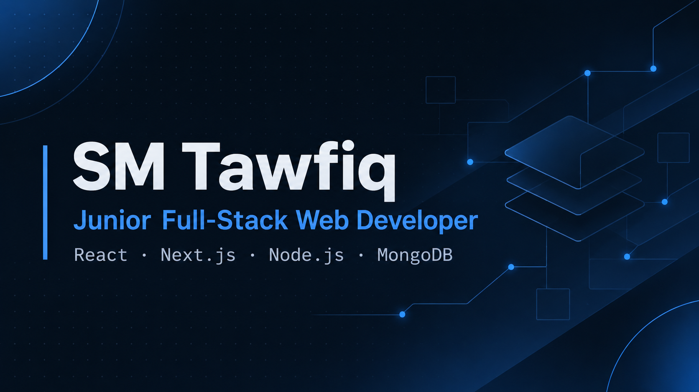

<p align="center">
  
</p>

<div align="center">
<h1>SM Tawfiq</h1>
<h3>Junior Full-Stack Web Developer</h3>
<picture>
  <source media="(prefers-color-scheme: dark)" srcset="https://readme-typing-svg.demolab.com/?font=Fira+Code&amp;size=20&amp;pause=1200&amp;color=58A6FF&amp;center=true&amp;vCenter=true&amp;width=620&amp;height=36&amp;lines=Junior+Full-Stack+Web+Developer;JavaScript+%7C+TypeScript;React+%7C+Next.js;Node.js+%7C+Express.js+%7C+MongoDB;Building+real-world+web+applications">
  
</picture>
<p><em>Turning ideas into practical web experiences, one project at a time.</em></p>
<p>
  <a href="mailto:sktwfqb69@gmail.com"><picture><source media="(prefers-color-scheme: dark)" srcset="https://skillicons.dev/icons?i=gmail&amp;theme=dark"></picture></a>
  &nbsp;&nbsp;
  <a href="https://github.com/tawfiqb69"><picture><source media="(prefers-color-scheme: dark)" srcset="https://skillicons.dev/icons?i=github&amp;theme=dark"></picture></a>
  &nbsp;&nbsp;
  <a href="https://www.linkedin.com/in/sm-tawfiq/"><picture><source media="(prefers-color-scheme: dark)" srcset="https://skillicons.dev/icons?i=linkedin&amp;theme=dark"></picture></a>
</p>
<p>
  <a href="#about-me">About</a> &nbsp;·&nbsp;
  <a href="#technical-skills">Skills</a> &nbsp;·&nbsp;
  <a href="#featured-projects">Projects</a> &nbsp;·&nbsp;
  <a href="#github-activity">Activity</a> &nbsp;·&nbsp;
  <a href="#lets-connect">Contact</a>
</p>
</div>

## About Me

I'm a Junior Full-Stack Web Developer from Bangladesh. I build responsive, user-friendly web applications with the JavaScript ecosystem, from REST APIs and authentication to the interfaces people actually use.

I enjoy turning ideas into real-world applications, solving problems, and continuously improving my skills.

```js
const tawfiq = {
  name: "SM Tawfiq",
  role: "Junior Full-Stack Web Developer",
  location: "Dhaka, Bangladesh",

  stack: {
    languages: ["JavaScript", "TypeScript"],
    frontend: ["React", "Next.js", "Tailwind CSS"],
    backend: ["Node.js", "Express.js", "MongoDB"],
    auth: ["Better Auth"],
    tools: ["Git", "GitHub"]
  },

  focus: [
    "Full-Stack Web Development",
    "REST API Development",
    "Modern Web Applications",
    "Authentication",
    "Practical Real-World Projects"
  ],

  mindset: "Learn → Build → Improve → Repeat"
};
```

## Technical Skills

<div align="center">
<p>
  <sub><b>LANGUAGES</b></sub><br/>
  <picture>
    <source media="(prefers-color-scheme: dark)" srcset="https://skillicons.dev/icons?i=js,ts&amp;theme=dark">
    
  </picture>
</p>
<p>
  <sub><b>FRONTEND DEVELOPMENT</b></sub><br/>
  <picture>
    <source media="(prefers-color-scheme: dark)" srcset="https://skillicons.dev/icons?i=html,css,tailwind,react,nextjs&amp;theme=dark">
    
  </picture>
</p>
<p>
  <sub><b>BACKEND DEVELOPMENT &amp; DATABASE</b></sub><br/>
  <picture>
    <source media="(prefers-color-scheme: dark)" srcset="https://skillicons.dev/icons?i=nodejs,express,mongodb&amp;theme=dark">
    
  </picture>
</p>
<p>
  <sub><b>AUTHENTICATION</b></sub><br/>
  <picture>
    
    
  </picture>
</p>
<p>
  <sub><b>TOOLS &amp; DEVELOPMENT ENVIRONMENT</b></sub><br/>
  <picture>
    <source media="(prefers-color-scheme: dark)" srcset="https://skillicons.dev/icons?i=git,github,vscode,npm&amp;theme=dark">
    
  </picture>
</p>
</div>

## Featured Projects

Four deployed applications. Each one links to a live demo and its source code.

<table width="100%">
<tr>
<td valign="top">
<h3><a href="https://studiospace-client-beta.vercel.app">StudioSpace</a></h3>
<p><strong>A full-stack creative studio discovery and booking platform.</strong></p>
<ul>
<li>Browse studios across five categories</li>
<li>Email/password and Google authentication</li>
<li>Create, update, and delete studio listings</li>
<li>Studio galleries, amenities, and reviews</li>
<li>Booking management with booking-conflict prevention</li>
<li>Personalized user dashboard</li>
<li>Light and dark theme support</li>
</ul>
<p><code>Next.js</code> <code>React</code> <code>JavaScript</code> <code>Tailwind CSS</code> <code>Node.js</code> <code>Express.js</code> <code>MongoDB</code> <code>Better Auth</code> <code>JWT</code></p>
<p>
<a href="https://studiospace-client-beta.vercel.app"></a>
<a href="https://github.com/tawfiqb69/studiospace-client"></a>
</p>
</td>
</tr>
</table>

<table width="100%">
<tr>
<td valign="top">
<h3><a href="https://b14-a07-bajar-dor.vercel.app/">Bazar-Dor</a></h3>
<p><strong>A full-stack platform that helps Bangladeshi users compare daily essential product prices across different markets.</strong></p>
<ul>
<li>Compare daily essential product prices</li>
<li>Explore products and market information</li>
<li>Responsive interface for different devices</li>
</ul>
<p>
<a href="https://b14-a07-bajar-dor.vercel.app/"></a>
<a href="https://github.com/tawfiqb69/b14-a07-bajar-dor"></a>
</p>
</td>
</tr>
</table>

<table width="100%">
<tr>
<td width="50%" valign="top">
<h3><a href="https://wanderlust-client-lac.vercel.app">Wanderlust</a></h3>
<p><strong>A travel-focused web application for exploring destinations.</strong></p>
<ul>
<li>Travel-oriented user experience</li>
<li>Responsive web interface</li>
</ul>
<p>
<a href="https://wanderlust-client-lac.vercel.app"></a>
<a href="https://github.com/tawfiqb69/wanderlust-client"></a>
</p>
</td>
<td width="50%" valign="top">
<h3><a href="https://tawfiqs-fit-log.vercel.app">FitLog</a></h3>
<p><strong>A workout planning and tracking application.</strong></p>
<ul>
<li>Browse workout exercises</li>
<li>Create personal workout plans</li>
<li>Save favorite workouts</li>
<li>Track workout progress</li>
</ul>
<p>
<a href="https://tawfiqs-fit-log.vercel.app"></a>
<a href="https://github.com/tawfiqb69/B14-A6-Fit-Log"></a>
</p>
</td>
</tr>
</table>

## GitHub Activity

<div align="center">
<p><sub><b>OVERVIEW &amp; TOP LANGUAGES</b></sub></p>
<p>
  
  
</p>
<p><sub><b>CONTRIBUTION STREAK</b></sub></p>
<!-- To make this card more reliable, self-host Streak Stats and replace streak-stats.demolab.com in BOTH URLs below with your own domain (see setup guide). -->
<picture>
  <source media="(prefers-color-scheme: dark)" srcset="https://streak-stats.demolab.com/?user=tawfiqb69&amp;hide_border=true&amp;theme=dark">
  
</picture>
<p><sub><b>CONTRIBUTION SNAKE</b></sub></p>
<picture>
  <source media="(prefers-color-scheme: dark)" srcset="https://raw.githubusercontent.com/tawfiqb69/tawfiqb69/output/github-contribution-grid-snake-dark.svg">
  
</picture>
</div>

## Let's Connect

I'm always interested in connecting with developers, collaborating on projects, and exploring new opportunities.

<p align="center">
  <a href="mailto:sktwfqb69@gmail.com">sktwfqb69@gmail.com</a> &nbsp;·&nbsp;
  <a href="https://www.linkedin.com/in/sm-tawfiq/">LinkedIn</a> &nbsp;·&nbsp;
  <a href="https://github.com/tawfiqb69">GitHub</a> &nbsp;·&nbsp;
  <a href="https://sm-tawfiq-portfolio.vercel.app">Portfolio</a>
</p>

<p align="center"><em>Learn. Build. Improve. Repeat.</em></p>
