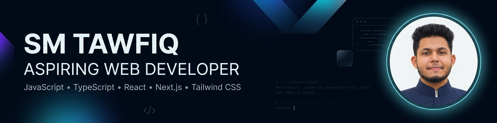

&#x20;\<p align="center">
&#x20; \
\</p>

\<div align="center">

# 👋 Hi, I'm SM Tawfiq

### Junior Full-Stack Web Developer

\

\<p>
&#x20; \<em>Turning ideas into practical web experiences, one project at a time.\</em>
\</p>

\<p>
&#x20; \<a href="[https://github.com/tawfiqb69](https://github.com/tawfiqb69)">
&#x20;   \
&#x20; \</a>
&#x20; \<a href="[https://github.com/tawfiqb69?tab=repositories](https://github.com/tawfiqb69?tab=repositories)">
&#x20;   \
&#x20; \</a>
\</p>

\<p>
&#x20; \<a href="mailto\:sktwfqb69\@gmail.com">Email\</a> •
&#x20; \<a href="[https://www.linkedin.com/in/sm-tawfiq/](https://www.linkedin.com/in/sm-tawfiq/)">LinkedIn\</a> •
&#x20; \<a href="[https://github.com/tawfiqb69](https://github.com/tawfiqb69)">GitHub\</a>
\</p>

\</div>

---

## 🧑‍💻 About Me

I'm a Junior Full-Stack Web Developer from Bangladesh, passionate about building responsive, user-friendly, and functional web applications.

I enjoy turning ideas into real-world applications, solving problems, and continuously improving my development skills.

```javascript
const tawfiq = {
  name: "SM Tawfiq",
  role: "Junior Full-Stack Web Developer",
  location: "Dhaka, Bangladesh",

  skills: [
    "JavaScript",
    "TypeScript",
    "React",
    "Next.js",
    "Node.js",
    "Express.js",
    "MongoDB"
  ],

  focus: [
    "Full-Stack Development",
    "REST API Development",
    "Modern Web Applications"
  ],

  mindset: "Learn → Build → Improve → Repeat"
};
```

---

## ⚡ Technical Skills

### Languages

\<p>
&#x20; \
\</p>

### Frontend Development

\<p>
&#x20; \
\</p>

### Backend Development & Database

\<p>
&#x20; \
\</p>

### Authentication

\<p>
&#x20; \
\</p>

### Tools & Development Environment

\<p>
&#x20; \
\</p>

---

## 🚀 Featured Projects

### 1. 🎨 StudioSpace

**A Full-Stack Creative Studio Discovery & Booking Platform**

A platform where users can discover creative workspaces and book studios across different categories.

**Key Features**

- Browse studios across five categories.
- Email/Password and Google authentication.
- Create, update, and delete studio listings.
- Studio galleries, amenities, and reviews.
- Booking management with booking conflict prevention.
- Personalized user dashboard.
- Light and Dark theme support.

**Tech Stack:** Next.js, React, JavaScript, Tailwind CSS, Node.js, Express.js, MongoDB, Better Auth, JWT.

\<p>
&#x20; \<a href="[https://studiospace-client-beta.vercel.app](https://studiospace-client-beta.vercel.app)">
&#x20;   \
&#x20; \</a>
&#x20; \<a href="[https://github.com/tawfiqb69/studiospace-client](https://github.com/tawfiqb69/studiospace-client)">
&#x20;   \
&#x20; \</a>
\</p>

---

### 2. 🛒 Bazar-Dor

**A Full-Stack Daily Essentials Price Comparison Platform**

A platform designed for Bangladeshi users to compare the prices of daily essential products across different markets.

**Key Features**

- Compare daily essential product prices.
- Explore products and market information.
- User-friendly browsing experience.
- Responsive interface for different devices.

**Focus:** Full-Stack Development, Product Data Management, and Practical Problem Solving.

\<p>
&#x20; \<a href="[https://b14-a07-bajar-dor.vercel.app/](https://b14-a07-bajar-dor.vercel.app/)">
&#x20;   \
&#x20; \</a>
&#x20; \<a href="[https://github.com/tawfiqb69/b14-a07-bajar-dor](https://github.com/tawfiqb69/b14-a07-bajar-dor)">
&#x20;   \
&#x20; \</a>
\</p>

---

### 3. 🌍 Wanderlust

**A Travel-Focused Web Application**

A web application focused on travel and exploring destinations.

**Focus**

- Travel-oriented user experience.
- Responsive web interface.
- Modern frontend development.
- Interactive web application features.

\<p>
&#x20; \<a href="[https://wanderlust-client-lac.vercel.app](https://wanderlust-client-lac.vercel.app)">
&#x20;   \
&#x20; \</a>
&#x20; \<a href="[https://github.com/tawfiqb69/wanderlust-client](https://github.com/tawfiqb69/wanderlust-client)">
&#x20;   \
&#x20; \</a>
\</p>

---

### 4. 🏋️ FitLog

**A Workout Planning & Tracking Application**

A fitness application designed to help users organize workout routines and track their fitness activities.

**Key Features**

- Browse workout exercises.
- Create personal workout plans.
- Save favorite workouts.
- Track workout progress.

**Focus:** Fitness Application Development, UI Design, and Application State Management.

\<p>
&#x20; \<a href="[https://tawfiqs-fit-log.vercel.app](https://tawfiqs-fit-log.vercel.app)">
&#x20;   \
&#x20; \</a>
&#x20; \<a href="[https://github.com/tawfiqb69/B14-A6-Fit-Log](https://github.com/tawfiqb69/B14-A6-Fit-Log)">
&#x20;   \
&#x20; \</a>
\</p>

---

## 📊 GitHub Statistics

\<div align="center">

\

\

\</div>

---

## 🔥 Contribution Streak

\<div align="center">

\

\</div>

---

## 🐍 Contribution Activity

\<div align="center">

\

\</div>

---

## 🤝 Let's Connect

I'm always interested in connecting with developers, collaborating on projects, and exploring new opportunities.

\<div align="center">

\<a href="[https://github.com/tawfiqb69](https://github.com/tawfiqb69)">   \ \</a> \<a href="[https://www.linkedin.com/in/sm-tawfiq/](https://www.linkedin.com/in/sm-tawfiq/)">   \ \</a> \<a href="mailto\:sktwfqb69\@gmail.com">   \ \</a>

\</div>

---

\<div align="center">

### 💡 Learn. Build. Improve. Repeat.

\

\</div>
